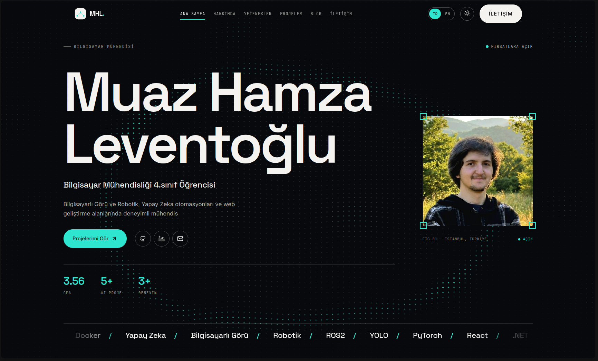

# 🚀 Personal Portfolio Website
[🌐Link](https://mhlev.com)



Modern, responsive portfolio website built with React + Vite + Supabase. Features a stunning glassmorphism design with smooth animations and dynamic data loading.


## ✨ Features

- **🎨 Modern Design** - Glassmorphism UI with gradient accents and smooth animations
- **📱 Fully Responsive** - Works perfectly on all devices
- **⚡ Fast Performance** - Built with Vite for lightning-fast load times
- **🔄 Dynamic Content** - All data loaded from Supabase (projects, blog posts, skills)
- **📝 Blog with Markdown** - Write blog posts in Markdown with syntax highlighting
- **🖼️ Markdown Images** - Upload images directly into blog content and project descriptions
- **🎭 Framer Motion** - Smooth page transitions and micro-animations

## 🛠️ Tech Stack

| Category | Technology |
|----------|------------|
| Frontend | React 19, React Router |
| Build Tool | Vite |
| Styling | Vanilla CSS with CSS Variables |
| Animations | Framer Motion |
| Icons | Lucide React |
| Database | Supabase (PostgreSQL) |
| Markdown | react-markdown, remark-gfm |


## 📁 Project Structure

```
src/
├── components/
│   ├── common/      # Navbar, Footer, etc.
│   ├── sections/    # Hero, About, Skills, Projects, Blog, Contact
│   └── ui/          # Skeleton loaders, shared UI
├── context/         # DataContext for global state
├── data/            # Sample/default data
├── lib/             # Supabase client
└── pages/           # Route pages & admin panel
```

## Shared design system

The portfolio combines editorial typography and numbered sections with translucent
surfaces, teal accents, the original navigation with understated controls, and subtle ambient motion.
The homepage, project collection, and blog pages share one public layout. Light
and dark themes and Turkish/English controls remain available on every page.

Shared material tokens live in `src/styles/surfaces.css`; `AmbientBackground`
provides the same background treatment for the public site and admin workspace.
Public styling is scoped in `src/styles/Portfolio.css`. Reduced-motion preferences
disable decorative animation, and touch layouts keep the ambient background static.

## Admin workspace

The admin panel uses translucent surfaces and the portfolio’s shared paper, ink, and teal palette. It follows the public site’s light/dark preference and includes a theme switch.
The overview shows actual portfolio totals, a 6/12-month content chart, profile
completion, recent projects, and recent posts. Select or focus a month on the chart to inspect its exact counts. Global search links directly to
management pages and individual content. Mobile layouts use the shared bottom navigation.

- `/admin` — overview
- `/admin/blog` — searchable blog library with tag filters
- `/admin/blog/new` — new Markdown post
- `/admin/blog/:id` — edit an existing post
- `/admin/projects`, `/admin/skills`, `/admin/experiences`, `/admin/profile` — portfolio management

Admin styles are scoped to the workspace. No additional dependencies or database
migrations are required for the redesign.

## PWA and mobile navigation

Production builds generate a web manifest, standalone app icons, and a service
worker with `vite-plugin-pwa`. Only the built app shell and static assets are
precached; Supabase responses, financial records, and uploaded PDFs are not cached
by the service worker. Reading current data and saving changes still require a
connection. New versions show a refresh notice instead of reloading an open form.
There is no in-app installation button or instruction dialog.

The HTML/body canvas and browser theme color follow both the selected theme and
the active portfolio/workspace palette. Safe-area padding protects controls around
camera cutouts and the home indicator, while the background fills those areas.
The manifest requests fullscreen mode for installed apps. On supporting Android
browsers this uses immersive mode, hiding the system status/navigation bars so the
page can fill their regions. Existing safe-area styles cover both fullscreen and
standalone fallback. The OS can reveal system bars temporarily; browsers that do
not support fullscreen fall back to standalone. Ordinary browser tabs keep their
normal browser UI. Existing installations may need a manifest update before the
launch mode changes. This behavior must be checked on an actual installed app;
desktop responsive previews do not reproduce Android's system-bar rendering.

The portfolio, admin, and finance bottom navigation support taps and hold-to-drag
selection. The glass indicator follows the pointer with a raised spring effect;
touch/pen dragging gives a short vibration when crossing into a new tab on devices
with the Vibration API. Repeated moves within one tab and mouse input stay silent;
unsupported or denied vibration does not affect navigation. Navigation happens
once on release. Releasing outside the bar or pressing Escape
cancels the selection. Keyboard navigation and reduced-motion preferences remain
supported. Finance page actions sit alongside their headings on small screens.
The public header shows Admin and Finance shortcuts only while authenticated;
the existing protected routes still validate access. On small screens these
shortcuts use labelled icons to keep the header compact.

The mobile bar uses a Chromium SVG backdrop-refraction layer, a capsule material,
contact illumination and a velocity-sensitive selection lens. Research sources,
accessibility behaviour and native/web differences are documented in
[`docs/liquid-glass-navigation.md`](docs/liquid-glass-navigation.md).

## Markdown image uploads

In the admin panel, use **Görsel yükle** above a blog's content or a project's description.
The uploaded image is inserted at the current selection as ``.
The last uploaded URL is also shown so it can be copied and reused with regular Markdown.
PNG, JPEG, WebP, GIF, and AVIF images up to 10 MB are supported.

Uploads use the existing Supabase public `images` bucket under `blog/content/` and
`projects/content/`. Configure `VITE_SUPABASE_URL` and `VITE_SUPABASE_ANON_KEY`, and
ensure the bucket's upload policies allow your admin users to insert objects at
these paths. Local storage fallback does not support image uploads. Embedded images
are stored independently of cover images; removing a Markdown reference does not
delete its image, so other posts can continue using the same URL.

## 👤 Author

**Muaz Hamza Leventoğlu**
- LinkedIn: [Muaz Hamza Leventoğlu](https://www.linkedin.com/in/muazhamza-leventoğlu-860109249)

## Kişisel finans — mevcut Supabase projesi

Finans aynı Supabase istemcisini ve mevcut admin Auth hesabını kullanır. Kurulum
`supabase/migrations/202611210001_finance_workspace.sql` dosyasındadır. SQL Editor'de
çalıştırmadan önce yalnızca `owner_email` değerini mevcut giriş e-postasıyla değiştirin.
Portfolyo tabloları değiştirilmez; tekrar çalıştırmak finans verisini sıfırlamaz.

`finance_workspace` tek kişisel çalışma alanını JSONB olarak saklar. Okuma RLS ile
sahibe sınırlıdır; yazma sadece `finance_save_workspace` RPC'sinden, revision ve
mutation kimliği kontrolüyle yapılır. Bir diğer sekme/cihazın yeni kaydı sessizce
ezilmez. Başarı yalnızca sunucu yanıtı doğrulandıktan sonra gösterilir. Belge sınırı
10 MB, her koleksiyonun sınırı 50.000 kayıttır; çok büyük arşivler için tablolar
ayrıştırılabilir. Veri modeli ve sonraki aşamalar `docs/finance-supabase-launch-plan.md`
belgesinde açıklanır.

İlk gerçek alan boş ve sıfır bakiyelidir. Hesaplar sayfasında hesap adı, başlangıç
bakiyesi ve başlangıç tarihi düzenlenebilir. PDF cihazda okunur; yalnızca onaylanan
işlemler ve import metadatası saklanır. Mevcut yerel demo verileri otomatik yüklenmez.
Yatırımlar ve tarihli değerlemeler kalıcıdır; piyasa fiyatları bu sürümde elle girilir.

Bağlantı yapılandırılmışsa hata halinde yerel demoya düşülmez. Yerel demo yalnızca
Supabase ayarları olmayan geliştirme ortamında kullanılabilir; üretimde varsayılan
`admin123` girişi kapalıdır. Public Supabase URL/anon anahtarı mevcut Vite ayarlarıdır;
service-role veya secret key tarayıcıya konmamalıdır.

`npm test` içindeki `financeSupabase.test.mjs`, SQL migration'ını PGlite üzerinde
çalıştırarak RLS, doğrudan yazma engeli, veri doğrulaması, eşzamanlı kayıt çatışması ve
idempotency davranışını gerçek PostgreSQL kurallarıyla doğrular.
